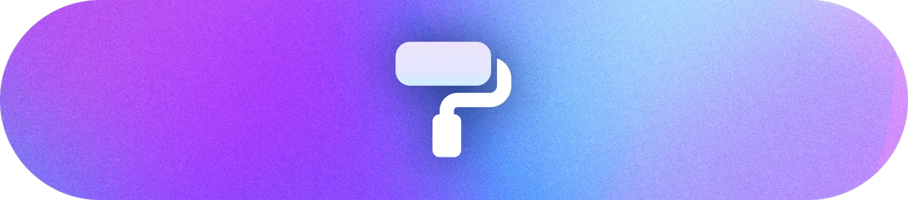
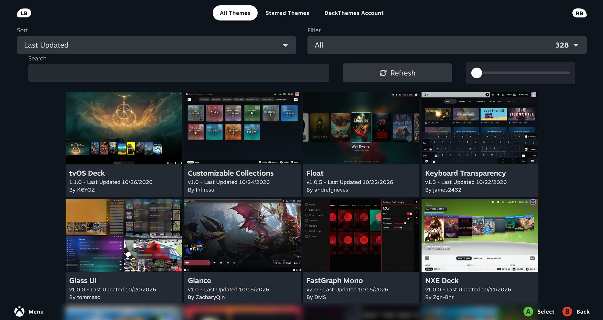
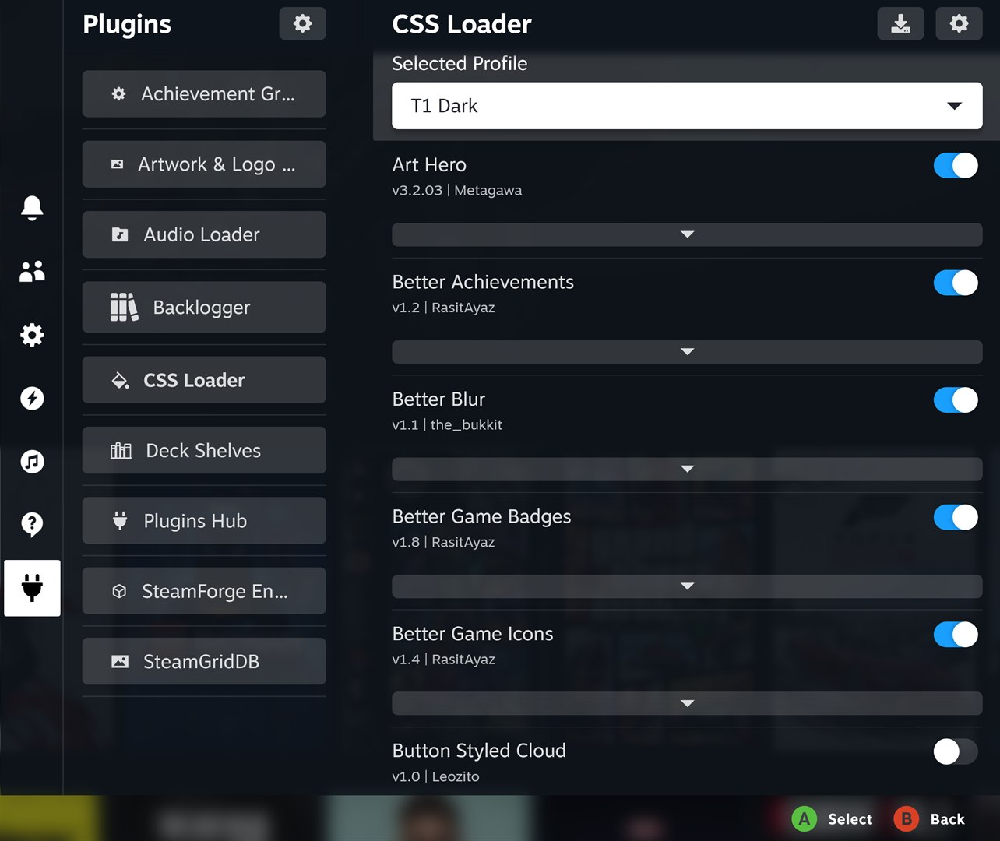

 

<h1 align="center"> CSS Loader for Millennium | UnOfficial </h1>

Make Steam look the way you want. Browse hundreds of community themes from [DeckThemes](https://deckthemes.com), mix and match as many as you like, and fine-tune each one with its own options, all without leaving Big Picture or the Steam desktop. Themes are in place the moment a window opens, with no flash of the stock look.

 

## Features
- Browse, search and install user-submitted themes from the DeckThemes store.
- Mix and match multiple themes to your liking.
- Customize themes through their "patches": dropdowns, sliders, toggles, color pickers and image pickers.
- Save the state of all your themes as a profile, and switch back to it later.
- Update prompts for your themes, with **Update All Themes** in the Themes tab of the settings.
- Star your favorite themes with a DeckThemes account.
- Custom images and fonts in themes, with no symlink or Developer Mode needed.
- **Live CSS Editing**: edit a theme's files and see the change in Steam within seconds.
- Themes made only for the desktop, or only for Big Picture, apply only in that mode.
- Works in Big Picture, on the Steam desktop, and on Steam's store and community pages.

## Usage
- **Steam desktop:** open Millennium's sidebar and select **CSS Loader**. The store and the settings open in their own window.
- **Big Picture:** the panel is in the Quick Access menu through the optional [Plugins Hub](https://github.com/DevsNate/PluginsHub-Millennium) plugin. Installed themes apply without it.

The panel lists your installed themes with a toggle each; expand a theme to change its options. The download button opens the store, and the cog opens the settings: Themes, Profiles, Settings, Donate and Credits.

## Themes from your Steam Deck
Themes live in `%USERPROFILE%\homebrew\themes`, the same folder and the same formats as the Decky plugin. Themes and profiles from a Steam Deck can be copied over as they are. To write your own theme, see the [DeckThemes documentation](https://docs.deckthemes.com/).

> [!NOTE]
> This is an **<ins>unofficial</ins>** port of [DeckThemes' CSS Loader for Decky Loader](https://github.com/DeckThemes/SDH-CssLoader), adapted to run on Windows in Steam's Big Picture and Desktop mode through [Millennium](https://steambrew.app). All credit for the plugin goes to DeckThemes and its contributors; please report problems with this port [here](https://github.com/DevsNate/CSSLoader-Millennium/issues), not upstream.

## Installation
1. Install [Millennium](https://steambrew.app)
2. Download the latest release from [Releases](https://github.com/DevsNate/CSSLoader-Millennium/releases)
3. Copy `css-loader.star` into `Steam/millennium/plugins` (requires a Starlight-capable Millennium, verified with v3.6.2)
4. Restart Steam and enable CSS Loader in Millennium's plugin settings

## Files the plugin writes
Your settings and DeckThemes login are kept in Millennium's config, `Steam/millennium/config/config.json`, in plain text. Besides that, the plugin only writes to two folders:

| File | What it holds |
|---|---|
| `homebrew\themes\<theme>\` | Installed themes, each with `config_USER.json`, your options for it |
| `homebrew\themes\<name>.profile\` | Your saved profiles |
| `homebrew\themes\css_translations.json` | Steam's current class names, from DeckThemes, so older themes keep working |
| `css-loader\startup.js` | Your enabled styles, so every Steam window is themed at first paint |
| `css-loader\ui-mode` | The last mode used, desktop or Big Picture |
| `css-loader\web\*.css` | Styles for Steam's store and community pages |

`homebrew` is in `%USERPROFILE%`; `css-loader` is in `Steam/millennium/plugins`.

## Building from source
See [DEVELOPMENT.md](DEVELOPMENT.md) for building, the project layout and updating from upstream.

## Credits
**Original plugin:** [DeckThemes](https://github.com/DeckThemes/SDH-CssLoader) (suchmememanyskill, Beebles and contributors). Themes are by their authors on [DeckThemes](https://deckthemes.com). Banner from [CSSLoader Desktop](https://github.com/DeckThemes/CSSLoader-Desktop).  
**Millennium port:** [DevsNate](https://github.com/DevsNate)

## License
[GPL-3.0-or-later](LICENSE), compatible with [the original plugin](https://github.com/DeckThemes/SDH-CssLoader)'s GPL-3.0. The libraries in `frontend/vendor/` keep their own licenses; see [its README](frontend/vendor/README.md).
